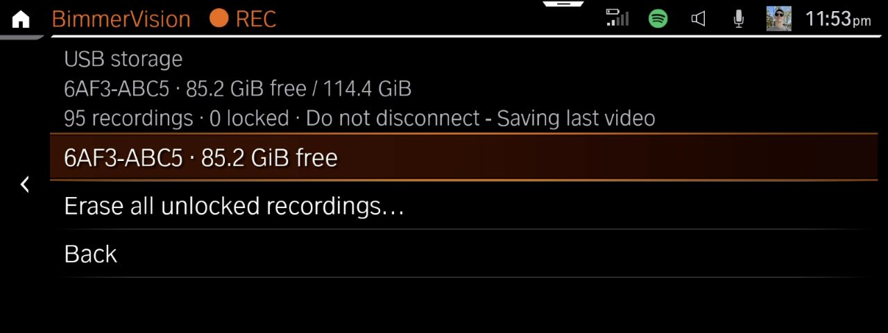
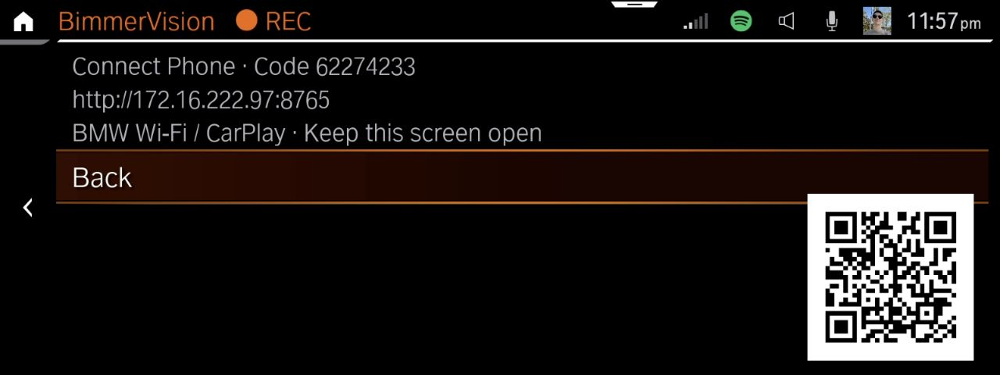

# BimmerVision

*Version 0.2.36 focuses on continuous recording and saved-video playback.*

**The first app to enable continuous recording of BMW’s 360° camera system directly to a USB flash drive on iDrive 7.** Save all four camera views and review or export your drives on your phone or computer.

**Requires a compatible BMW with a 360° Surround View camera system and iDrive 7 (MGU).** A rear-view camera on its own is not enough. iDrive 8 and other head units are not currently tested.

[Visit BimmerVision.App](https://BimmerVision.App) · [Latest release](https://github.com/Hexphase/BimmerVision/releases/latest)

## Features

- **Four camera views:** Review the front, rear, left and right cameras, individually or together.
- **Record directly to USB:** Keep your recordings on your own drive.
- **Enable once for automatic recording:** BimmerVision remembers your setting and handles future drives when the cameras and USB storage are available.
- **See when recording is active:** A blinking **REC** indicator appears in iDrive.
- **Driving information:** Review recorded speed, steering, blinkers, brake and accelerator information alongside the video, where available.
- **Scrub through your drive:** Drag the timeline to seek within a clip or move between recordings. Alternating BMW M colors make clip boundaries easier to spot.
- **Remember camera assignments:** Identify each camera view and save your choices for that recording.
- **Protect important footage:** Lock recordings in the player. Erasing unlocked recordings from iDrive keeps locked recordings protected.
- **Follow your route:** View recorded GPS locations on the map. Speed limits appear when an explicit value is available.
- **Export your way:** Save a camera view or a four-camera video, with your choice of driving overlays, date/time and route map.
- **One Install action:** MGU Store automatically installs the required recorder companion with BimmerVision.


## What you need

- A **compatible BMW with a 360° Surround View camera system**.
- **iDrive 7 (MGU)** with **MGU Store** installed.
- A writable USB drive connected to a USB port the car can use for recording.
- A phone or computer to review and export footage.

Compatibility has been physically tested on the project’s iDrive 7 setup. Camera-stream and vehicle-information availability can vary between cars.

### BMW Drive Recorder subscription

BimmerVision’s direct camera capture in **0.2.10 and newer** does not use BMW’s licensed Drive Recorder recording service or perform a subscription check. It requests the camera stream directly and records the compressed footage to USB.

On the tested iDrive 7 car, recording works with the official BMW Drive Recorder setting switched **off**, including while the official app is suspended. That car still has an activated Drive Recorder entitlement, so operation on a car without an active subscription has **not yet been physically verified**. Versions before 0.2.10 may depend on an already-active camera stream; this direct-capture behavior should not be assumed for them.


## Install from MGU Store

1. Add **Hexphase/BimmerVision** as a source in MGU Store.
2. Find **BimmerVision** and press **Install**. Its recorder companion installs automatically—there is no separate companion setup to complete.
3. If prompted to **Restart iDrive to finish setup**, park the car and use the Store’s restart action.
4. Connect your USB drive, open **BimmerVision**, and choose **Enable recording**.

On first opening BimmerVision, acknowledge the reminder to turn off other third-party apps that use the cameras. Those apps can interfere with recording and prevent capture of all camera views.

First-time camera setup runs automatically. If setup is still preparing, give it time to finish. BimmerVision does not restart iDrive automatically.

## Manage your USB drive

Open **USB storage** in the car app to see available space, the recording count and how many recordings are locked.



**Erase all unlocked recordings** asks for confirmation and keeps locked recordings. Removing or updating the app does not erase the recordings on your USB drive.

To remove your drive, pause recording and wait until the USB page says **Safe to Remove** before unplugging it.

In 0.2.36, the app writes diagnostic logs only while recording is enabled to **BimmerVision-Logs**, next to the **BimmerVision** recordings folder. App-owned logs rotate under a combined **64 MiB** cap and survive erasing recordings. When reporting a problem, include the approximate incident time and a ZIP of this logs folder. Logs capture recording health, failures and CPU load without raw location telemetry or pairing credentials.

## Watch on your phone

1. Open **Connect Phone** in BimmerVision on the car.
2. Use your car’s BMW Wi-Fi / CarPlay connection.
3. Scan the QR code **shown on your car’s screen** to open the player on your phone.
4. Keep the **Connect Phone** page open in iDrive while reviewing or downloading footage.



Choose a drive, select a recording, and drag the timeline to review it. Each recording downloads completely before playback starts; loading time depends on the recording size and your connection.

Recordings that are still being captured appear in the library only after that clip finishes.

## Watch on your computer

Visit **[BimmerVision.App](https://BimmerVision.App)** on your computer and connect your recording USB drive to view its footage.

You can also use **[BimmerVision Web on GitHub Pages](https://hexphase.github.io/BimmerVision-Web/)** to open a USB folder or connect to your car by IP address or QR code. Direct hosted connections require **BimmerVision 0.2.8 or newer** and a browser with local-network access support.

For the car’s built-in player, use **Connect Phone** on the car app’s main page.

## Updates and rollback

Update the app and recorder together through MGU Store. Before updating, retain the previous release’s app and recorder packages and their checksums. To roll back, reinstall the previous app and recorder packages together through MGU Store. Recordings on USB are preserved; a rollback across older settings schemas may need those settings selected again.

## Updates and available information

Install updates through **MGU Store** to update BimmerVision and its recorder companion together. The web player also checks for newer GitHub Releases using the viewing device’s Internet connection.

GPS, speed limits and other driving information are shown only when the required data is available. A blank speed-limit sign means an explicit limit could not be retrieved; BimmerVision does not invent a number.

<details>
<summary>Build from source</summary>

Use a current Node.js version on your development computer. No third-party npm dependencies are required.

```sh
npm run build
npm test
```

The build creates the BimmerVision app package, required recorder package, Store catalog and `CAR-SHA256SUMS`. The head-unit runtime targets iDrive 7 MGU Linux x86-64 and Node 8. For normal installation, use MGU Store as described above.

</details>
